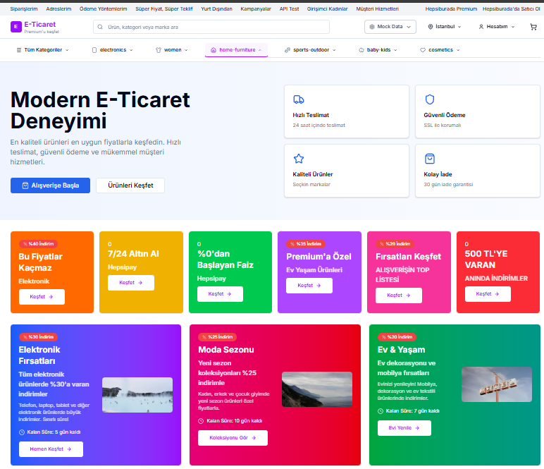
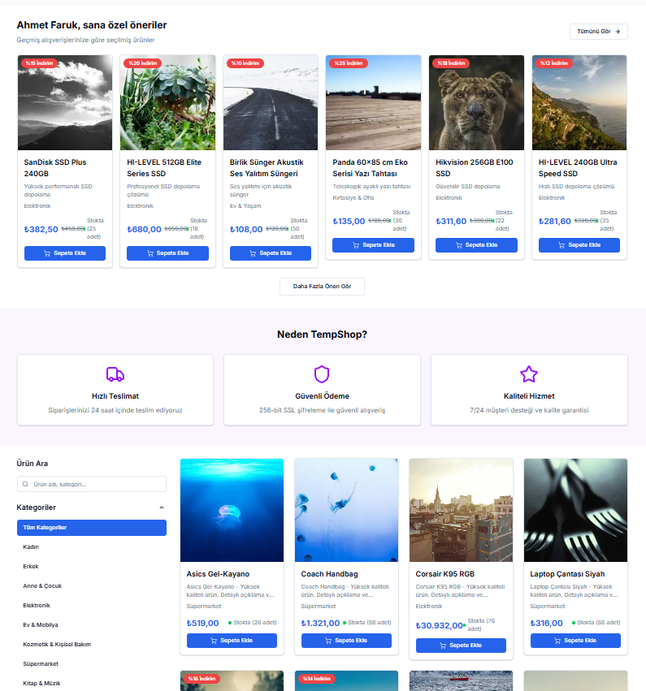
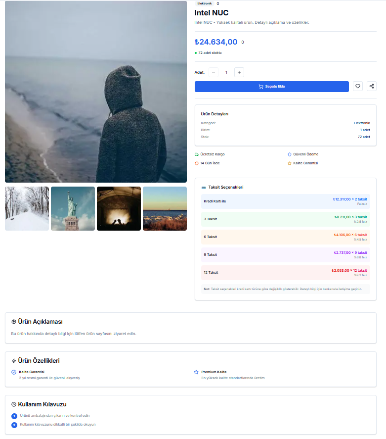
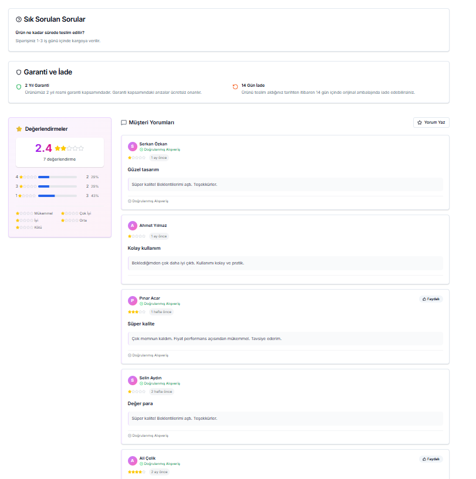

# Temp-Shop

Next.js 16, TypeScript ve Tailwind CSS ile yazılmış bir e-ticaret arayüzü. Veriyi üç yerden alabiliyor: uygulamanın içine gömülü mock veri, bir .NET Core API'si ya da bir Spring Boot API'si. Hangisinin kullanılacağını navbar'daki seçiciden ya da ortam değişkeninden değiştirebilirsiniz.

Canlı demo GitHub Pages'te, mock veriyle çalışıyor: https://mihrimatrix.github.io/Temp-Shop/

`nextjs` `typescript` `ecommerce` `tailwindcss` `zustand` `radix-ui` `react-hook-form` `zod` `axios` `dotnet-core` `spring-boot` `github-pages`

## Ekran görüntüleri

Ana sayfa: hero alanı, kampanya bannerları ve öne çıkan ürünler.



Ürün listesi, kişiye özel öneriler ve kategori filtreleri.



Ürün detayı, taksit seçenekleri ve ürün özellikleri.



Müşteri yorumları ve sık sorulan sorular.



## Neler var

Alışveriş tarafında ürün listeleme (grid ya da liste, sayfalama), arama popup'ı (günün favorileri, en çok arananlar, otomatik tamamlama), sepet, ödeme akışı ve sipariş geçmişi var. Kullanıcı favori ekleyebiliyor, birden fazla adres ve kart kaydedebiliyor, şehir ve ilçe seçebiliyor (GPS ile de olur).

Kategoriler mega menüden geliyor. Masaüstünde açılır menü, mobilde hamburger menü olarak gösteriliyor. Kampanyalar, premium üyelik, satıcı başvurusu, müşteri hizmetleri ve yardım sayfaları da hazır. Hesap tarafında 2FA ve şifre değiştirme için bir güvenlik sayfası, bildirim tercihleri ve backend adreslerinin düzenlendiği bir ayarlar sayfası bulunuyor.

Sayfalarda metadata, Open Graph ve structured data tanımlı; `robots.txt` ve `sitemap.xml` build sırasında üretiliyor.

## Teknolojiler

- Next.js 16 (App Router), React 19
- TypeScript 5.9, strict mode açık
- Tailwind CSS 4
- Zustand 5 (sepet, oturum, ürün ve backend ayarları)
- Radix UI ve Lucide ikonları
- React Hook Form ve Zod ile form doğrulama
- Axios
- React Hot Toast

## Kurulum

```bash
npm install
cp .env.example .env.local
npm run dev
```

Ardından http://localhost:3000 adresini açın.

Varsayılan backend `mock`. Bunun için başka hiçbir şey çalıştırmanız gerekmiyor. Gerçek bir API kullanmak isterseniz `.env.local` içinde şunu değiştirin:

```bash
NEXT_PUBLIC_BACKEND_TYPE=mock    # ya da dotnet, spring
NEXT_PUBLIC_DOTNET_API_URL=http://localhost:5000/api
NEXT_PUBLIC_SPRING_API_URL=http://localhost:8081/api
```

.NET ve Spring Boot backend'leri bu repoda değil, ayrı projeler olarak çalışıyor. Hangi yolları beklediğini `src/config/api.ts` gösteriyor. İki backend de tekil controller yolları kullanıyor (`/product`, `/category`, `/order`, `/auth/login` gibi).

## Build ve yayınlama

Uygulama statik export olarak derleniyor (`output: "export"`), yani `npm run build` sonunda `out/` klasöründe sunucu gerektirmeyen HTML dosyaları oluşuyor.

```bash
npm run build       # out/ klasörünü üretir
npm run check-links # out/ içindeki her iç linkin bir sayfaya gittiğini kontrol eder
npm run type-check  # tsc --noEmit
```

CI, deploy etmeden önce `check-links` çalıştırıyor; kırık bir link varsa yayın durur.

### GitHub Pages

`master` dalına her push'ta `.github/workflows/deploy.yml` siteyi derleyip Pages'e yükler. İlk seferde repo ayarlarından bir kez şunu yapmanız gerekiyor: Settings > Pages > Source alanını "GitHub Actions" olarak seçin.

Workflow, `NEXT_PUBLIC_BASE_PATH` değerini repo adından alıyor (`/Temp-Shop`). Repoyu başka bir adla fork'larsanız ek bir ayar gerekmez.

Pages'te sunucu olmadığı için tüm ürün ve kategori sayfaları build sırasında mock veriden üretiliyor. Gerçek bir backend'e geçtiğinizde, mock verisinde olmayan bir ürün ID'sinin detay sayfası Pages üzerinde 404 verir. Ürün detayını gerçek backend'le kullanacaksanız uygulamayı `npm run dev` ile ya da kendi sunucunuzda çalıştırın.

### Docker

```bash
docker compose up --build
```

İmaj `out/` klasörünü nginx ile sunuyor. Site http://localhost:2364 adresinde açılıyor.

## Proje yapısı

```
src/
├── app/            # App Router sayfaları (products, categories, cart, checkout, orders, ...)
├── components/     # Navigasyon, ürün kartları, modallar; ui/ altında temel bileşenler
├── config/api.ts   # Backend endpoint yolları
├── data/           # Mock ürünler, kullanıcılar ve mega menü verisi
├── lib/            # Yardımcı fonksiyonlar, kategori route çözümleme
├── services/       # Her kaynak için API servisi; mock modda mock-data-service'e düşer
├── store/          # Zustand store'ları
└── types/          # Ortak TypeScript tipleri
```
